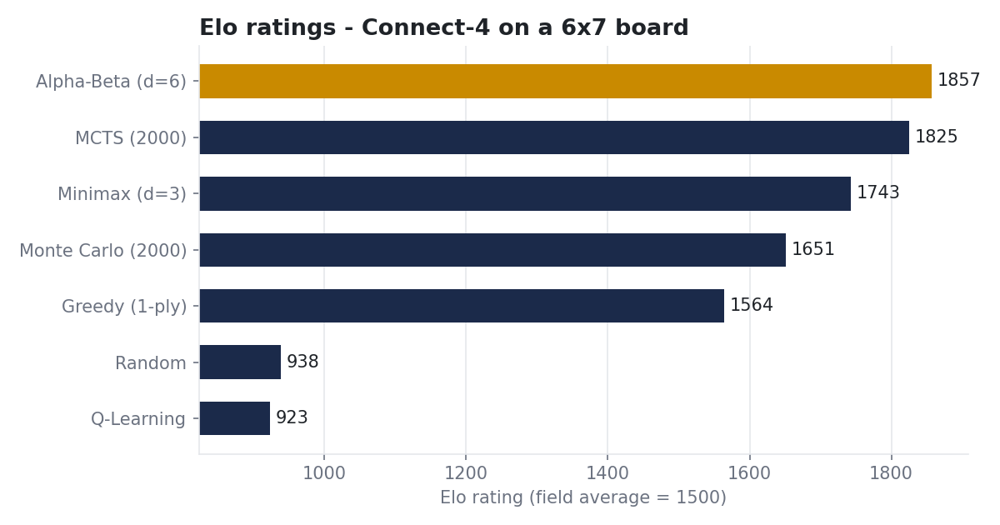
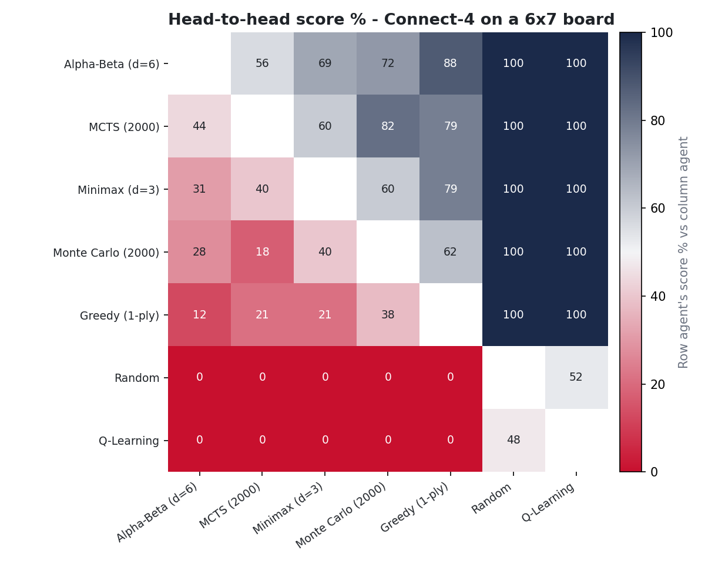
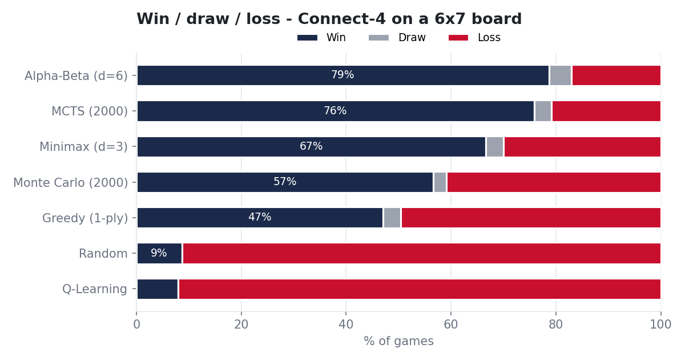
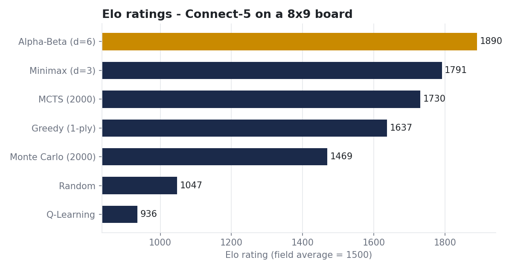
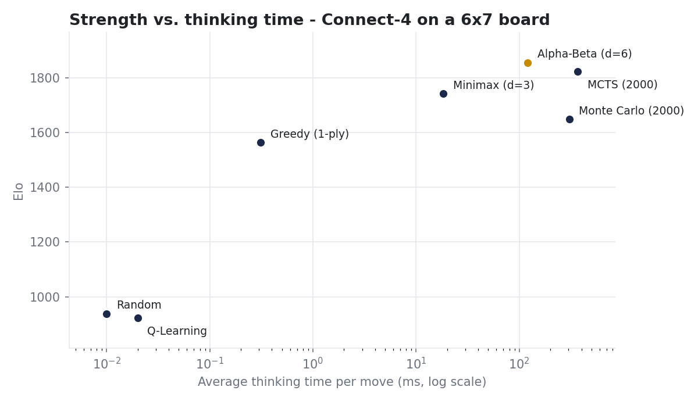
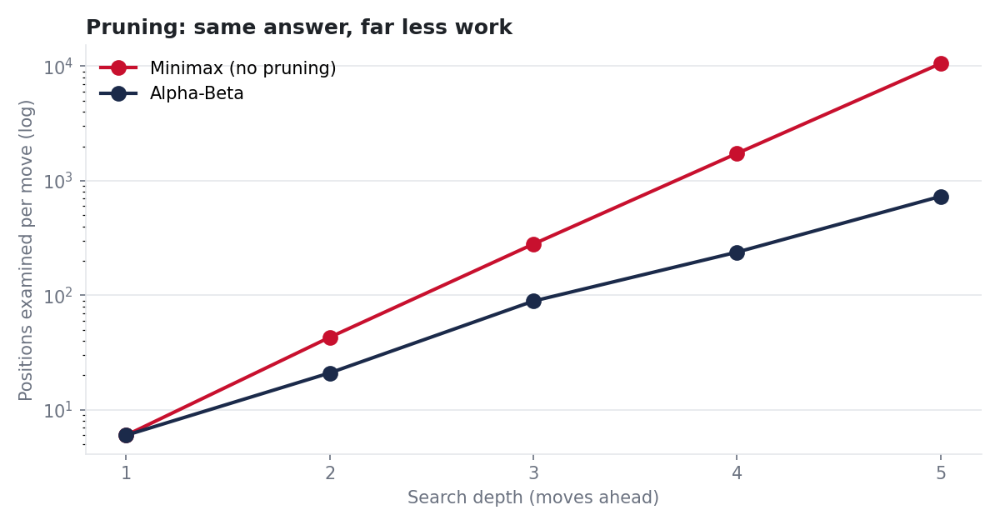
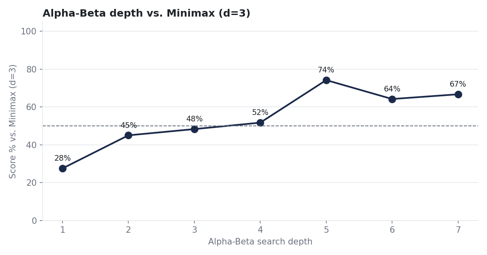
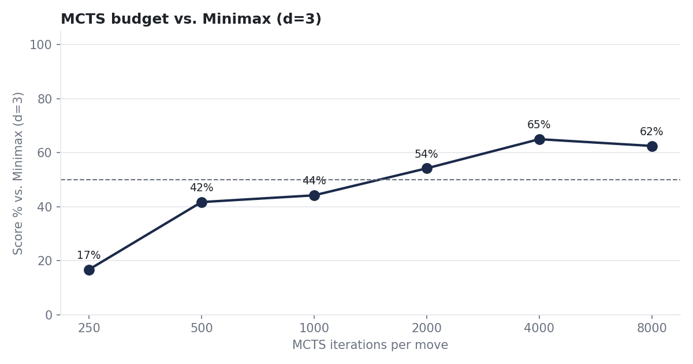

# Which AI Plays Connect-N Best?

**A comparison of seven game-playing algorithms over 1,260 tournament games**

---

## 1. Summary

I built a Connect-N game (Connect 4 generalised to any board size and any number in a row) and implemented seven algorithms to play it. Every algorithm then played every other one in a round-robin tournament on two boards: classic **Connect 4 (6x7)** and **Connect 5 (8x9)**.

| | Connect 4 (6x7) | Connect 5 (8x9) |
|---|---|---|
| **Best** | Alpha-Beta: 1857 Elo, 80.8% score | Alpha-Beta: 1890 Elo, 86.2% score |
| **Runner-up** | MCTS: 1825 Elo, 77.5% | Minimax: 1791 Elo, 76.2% |
| **Worst** | Q-Learning: 923 Elo, 7.9% (below Random) | Q-Learning: 936 Elo, 5.0% (below Random) |

- **Best overall: Alpha-Beta pruning.** It finished first on both boards and won all 12 of its head-to-head matchups. No algorithm beat it over a series. Its lead was clearest on the bigger Connect 5 board (86.2% score, only 11 losses in 120 games). On Connect 4, MCTS came closest and lost to it 44% to 56%.
- **Worst: tabular Q-Learning.** It scored *below* the Random baseline on both boards. The game has about 4.5 trillion positions, and a lookup table can't generalise from the positions it has seen to the ones it hasn't. Once a game leaves familiar territory, it is effectively moving at random.

---

## 2. The game

`connectn/board.py` implements Connect-N with a **bitboard**: each player's pieces are stored as the bits of one integer. Each column gets one spare bit on top, so lines can't wrap around from one column into the next. A line of N pieces in direction `d` exists exactly when

```
b & (b >> d) & (b >> 2d) & ... & (b >> (N-1)d) != 0
```

with `d` = 1 (vertical), rows+1 (horizontal) and rows / rows+2 (the two diagonals). A win check is therefore a handful of integer operations. That speed is what made 1,260 full AI-vs-AI games, plus the experiments, feasible in pure Python. A full random game takes about 0.1 ms.

The engine supports any `rows x cols` board and any `N`. `play.py` lets a human play against any of the algorithms, or watch two of them play each other.

---

## 3. The algorithms: what, how and why

I picked the seven algorithms to cover the four classic families of game AI: **baselines**, **search**, **sampling** and **learning**. Search and sampling algorithms get a **fixed amount of computation** per move (a search depth or a number of simulations), not a time limit. That makes the results reproducible on any machine.

### 3.1 Random (baseline)
- **How:** plays a uniformly random legal column.
- **Why:** it sets the floor. Any algorithm that can't clearly beat Random has learned nothing useful.

### 3.2 Greedy (rule-based, 1-ply)
- **How:** 1) play a winning move if there is one; 2) otherwise block the opponent's immediate win; 3) avoid moves that let the opponent win by playing on top; 4) otherwise pick the move with the best **heuristic score** (below).
- **Why:** it shows how far hand-written rules can go with no look-ahead. It's the simplest "intelligent" player and roughly how a beginner plays.

**The heuristic** (shared with Minimax and Alpha-Beta): look at every possible N-length line on the board. If a line holds only my pieces, add a weight that grows steeply with how many pieces it has (1, 4, 16, ... and 1,000 for N-1 in a row). If it holds only the opponent's pieces, subtract the same weight. Lines with both colours are dead and score nothing. A small bonus goes to centre-column pieces, which take part in the most lines.

### 3.3 Minimax (depth 3)
- **How:** builds the full tree of move sequences 3 turns deep and scores the leaves with the heuristic. It assumes the opponent always picks the reply that's worst for us, and chooses the move whose worst case is best. It is implemented in negamax form, and wins found sooner score higher.
- **Why:** it is the textbook algorithm for two-player, zero-sum, perfect-information games, and the foundation of classic chess engines. It explores every branch, so its cost grows as about 7^depth.

### 3.4 Alpha-Beta pruning (depth 6)
- **How:** minimax plus three improvements:
  1. **Alpha-beta pruning:** stops exploring a branch as soon as it is proven worse than an alternative already found. The answer is mathematically identical to minimax.
  2. **Move ordering:** tries centre columns first, so good moves are found early and more branches get pruned.
  3. **Transposition table:** remembers positions already evaluated in the current search, because different move orders often lead to the same board.
- **Why:** to measure how much efficiency is worth. Pruning makes a search about twice as deep affordable for the same cost. I checked that Alpha-Beta picks exactly the same moves as Minimax at equal depth (70 of 70 test positions, all ties accounted for).

### 3.5 Flat Monte Carlo (2,000 playouts)
- **How:** for each legal column, plays an equal share of 2,000 completely random games to the end, then picks the column with the best average result. No tree and no heuristic.
- **Why:** it needs no knowledge of strategy, only the rules. It shows how much random simulation alone can tell you.

### 3.6 Monte Carlo Tree Search, UCT (2,000 iterations)
- **How:** each iteration runs four phases:
  1. **Select:** walk down the tree, picking the child that maximises `wins/visits + 1.41 * sqrt(ln(parent visits) / visits)`. This UCT rule balances exploiting good moves with exploring rarely tried ones.
  2. **Expand:** add one untried move as a new node.
  3. **Simulate:** play random moves to the end of the game.
  4. **Backpropagate:** credit the result to every node on the path.

  After 2,000 iterations it plays the most-visited move.
- **Why:** it is the modern successor to flat Monte Carlo (and part of AlphaGo). It spends its simulations on promising lines instead of evenly, so it can see that a move which looks good has a refutation. It gets **the same 2,000 simulations** as flat Monte Carlo, so comparing the two isolates the value of the tree.

### 3.7 Tabular Q-Learning (50,000 self-play games)
- **How:** keeps a table `Q[position][column]`. It trains by playing 50,000 games against itself, choosing the best-known move most of the time and a random move with probability epsilon (decaying from 0.2 to 0.05) to explore. After each move it updates `Q[s][a] += 0.3 * (target - Q[s][a])`, where the target is +1 for a winning move, 0 for a draw, and otherwise **minus** the opponent's best value in the next position (negamax form). In a game it plays the highest-valued column. For a position it has never seen, it has no information and plays randomly.
- **Why:** it is the only algorithm that is told nothing about strategy and has to learn from experience. Reinforcement learning is behind famous game AIs, so it is the obvious representative of "learning".

---

## 4. Methodology

**Round robin.** All 21 pairings were played: 40 games per pairing in Connect 4 (840 games) and 20 games per pairing in Connect 5 (420 games), on 6 CPU cores.

**Openings and colours.** Each pair of games starts from a random 2-move opening and is played twice, once with each algorithm moving first. All pairings use the same list of openings.

> **A lesson learned along the way.** In my first run, games didn't use random openings. Minimax, Alpha-Beta and Greedy are nearly deterministic, so they kept replaying the same game. Some pairings produced only **2 distinct games out of 20**, and the results were distorted: Minimax at depth 3 appeared to beat Alpha-Beta at depth 6. A depth-scaling experiment gave a nonsensical zig-zag, which exposed the problem. I switched to the opening scheme above, which is the standard fix used in chess-engine testing, and re-ran everything. **Every pairing now has 20 distinct games out of 20**, and all the results below come from that corrected run.

**Ratings.** Score % counts a win as 1 and a draw as 0.5. Elo ratings were fitted to all games at once with a Bradley-Terry model (field average = 1500). A 100-point gap means the stronger side is expected to score about 64%.

**Fairness check.** In Connect 4, the first player won 48.3% of games, the second player 49.3%, and 2.4% were draws. The opening scheme removes the first-move advantage from the comparison.

---

## 5. Results

### 5.1 Connect 4 (6x7), 840 games

| Rank | Algorithm | Elo | Score | W-D-L | ms / move |
|---|---|---|---|---|---|
| 1 | **Alpha-Beta (d=6)** | **1857** | **80.8%** | 189-10-41 | 121 |
| 2 | MCTS (2,000) | 1825 | 77.5% | 182-8-50 | 369 |
| 3 | Minimax (d=3) | 1743 | 68.3% | 160-8-72 | 18 |
| 4 | Monte Carlo (2,000) | 1651 | 57.9% | 136-6-98 | 305 |
| 5 | Greedy | 1564 | 48.8% | 113-8-119 | 0.31 |
| 6 | Random | 938 | 8.8% | 21-0-219 | 0.01 |
| 7 | Q-Learning | 923 | 7.9% | 19-0-221 | 0.02 |





The head-to-head matrix shows an almost perfect pecking order. Each algorithm beats everything below it in the table. Alpha-Beta's row is positive everywhere: 56% vs MCTS, 69% vs Minimax, 73% vs Monte Carlo, 88% vs Greedy and 100% vs Random and Q-Learning. Every search and sampling algorithm won **every single game** against Random and Q-Learning.



### 5.2 Connect 5 (8x9), 420 games

| Rank | Algorithm | Elo | Score | W-D-L | ms / move | Connect 4 rank |
|---|---|---|---|---|---|---|
| 1 | **Alpha-Beta (d=6)** | **1890** | **86.2%** | 98-11-11 | 527 | 1 |
| 2 | Minimax (d=3) | 1791 | 76.2% | 89-5-26 | 60 | 3 |
| 3 | MCTS (2,000) | 1730 | 69.6% | 80-7-33 | 654 | 2 |
| 4 | Greedy | 1637 | 59.2% | 65-12-43 | 0.65 | 5 |
| 5 | Monte Carlo (2,000) | 1469 | 42.1% | 49-3-68 | 633 | 4 |
| 6 | Random | 1047 | 11.7% | 14-0-106 | 0.01 | 6 |
| 7 | Q-Learning | 936 | 5.0% | 6-0-114 | 0.02 | 7 |



On the bigger board, Alpha-Beta's lead grows: 72.5% against its closest rival, Minimax. The two **sampling methods drop**. MCTS falls from 2nd to 3rd, and flat Monte Carlo falls below Greedy. Random playouts of 40+ moves on a 72-square board say much less about who is really winning, so their estimates get noisier. The heuristic-guided searchers don't have that problem.

### 5.3 Strength vs. thinking time



Alpha-Beta is the strongest player **and** needs only a third of MCTS's thinking time (121 ms vs 369 ms per move in Connect 4). Minimax, at 18 ms per move, gives the most strength per millisecond. Greedy is nearly free (0.3 ms) and is a respectable mid-table player. Thinking time is single-core Python on the test machine. Only the relative sizes matter.

### 5.4 Experiment A: what pruning buys

Nodes examined per move, averaged over 25 mid-game positions:

| Depth | Minimax | Alpha-Beta | Saving |
|---|---|---|---|
| 1 | 6 | 6 | 1x |
| 2 | 43 | 21 | 2x |
| 3 | 280 | 89 | 3x |
| 4 | 1,732 | 238 | 7x |
| 5 | 10,541 | 730 | **14x** |



The saving grows with every extra level. That is why Alpha-Beta could afford depth 6 in the tournament while Minimax was held to depth 3.

### 5.5 Experiment B: does deeper search help?

Alpha-Beta at depths 1 to 7 played Minimax (depth 3), 60 games per depth.

| Depth | 1 | 2 | 3 | 4 | 5 | 6 | 7 |
|---|---|---|---|---|---|---|---|
| Score vs Minimax d=3 | 27.5% | 45.0% | 48.3% | 51.7% | 74.2% | 64.2% | 66.7% |
| ms / move | 0.5 | 1.5 | 5.4 | 15 | 39 | 87 | 188 |



At depth 3, Alpha-Beta *is* Minimax with less work, and it scores 48%, close to the expected 50%. That is a good sanity check. Strength rises with depth and levels off at about 65-75% from depth 5. With 60 games, each point carries roughly ±6 points of noise, so the dip at depth 6 is within noise.

### 5.6 Experiment C: does MCTS improve with more simulations?

| Simulations / move | 250 | 500 | 1,000 | 2,000 | 4,000 | 8,000 |
|---|---|---|---|---|---|---|
| Score vs Minimax d=3 | 16.7% | 41.7% | 44.2% | 54.2% | 65.0% | 62.5% |
| ms / move | 44 | 75 | 152 | 298 | 614 | 1,181 |



MCTS is weak with a small budget, overtakes Minimax at about 2,000 simulations, and levels off at 4,000-8,000. Each doubling of the budget doubles the thinking time for a smaller gain.

---

## 6. The best algorithm: Alpha-Beta

Alpha-Beta is the clear overall winner:

- **#1 on both boards**, with the highest average Elo (1874; next best is MCTS at 1778).
- **Won all 12 head-to-head matchups**: no algorithm beat it over a series on either board.
- **Most dominant on the harder board:** 86.2% score in Connect 5, and at least 72.5% against every opponent there.
- **Efficient:** it was the strongest player while thinking 3x faster than MCTS.

The one caveat: on classic Connect 4 its edge over MCTS is real but modest (56% to 44% head-to-head, a 32-point Elo gap). "By far" describes the overall picture and Connect 5, not every single matchup.

**Why it wins.** It combines the two things that matter most in a tactical game like Connect-N:

1. **Look-ahead.** Six moves deep, it sees traps and forced wins that shallower or sampling-based players miss. Experiment B shows strength rising with depth.
2. **Efficiency.** Pruning, move ordering and the transposition table make that depth affordable: 14x fewer positions at depth 5 for the same answer.

A sensible heuristic (counting open lines) guides it in positions too deep to calculate to the end. As the board grows, this guidance matters more and random playouts matter less, which is why its lead grows on Connect 5.

---

## 7. The worst algorithm: Q-Learning, and why

**Random is the floor by design, so the meaningful "worst algorithm" is the one that should have done better and didn't: tabular Q-Learning.** It finished *last*, below Random, on both boards: 7.9% vs Random's 8.8% in Connect 4, and 5.0% vs 11.7% in Connect 5. It lost to Random head-to-head in Connect 5 (30%) and was level with it in Connect 4 (47.5%). Apart from its games against Random, it never won a single game against any algorithm.

Why it fails:

1. **The state space is far too big for a table.** Connect 4 has about 4.5 trillion legal positions. Fifty thousand self-play games taught it about 678,000, roughly 0.00002% of them, and Connect 5 on 8x9 has vastly more.
2. **Most positions it meets are new.** It knew only **54.6%** of the positions it faced in Connect 4 and **25.3%** in Connect 5. Most of the known ones are early-game boards it saw during training. For every unknown position it moves at random, so in the middlegame and endgame, where games are decided, it plays like Random.
3. **A table can't generalise.** Knowing a value for one board says nothing about a board that differs by a single piece. Every position must be learned separately, so learning never "adds up" to strategy.
4. **What it did learn is biased.** It learned from games against itself, so its values describe its own exploratory, mostly random play. When it does recognise a position, it trusts values that don't hold against a real opponent. That's why it can do *worse* than pure Random: its confident moves in known positions are sometimes confidently wrong.

**What would fix it:** replacing the table with a function approximator, such as a neural network that generalises between similar positions, and combining learning with search, as AlphaZero does. That needs orders of magnitude more computation than a fair, laptop-scale comparison allows. The result is a good illustration of *why* those techniques were necessary.

---

## 8. Conclusions

1. **Look-ahead wins.** The search algorithms with a heuristic, led by Alpha-Beta, topped both tournaments.
2. **Pruning is free strength.** Alpha-Beta gives the same answer as Minimax for a fraction of the work, and the saved effort becomes extra depth.
3. **MCTS is the strongest knowledge-free method.** Using only the rules, it came within 32 Elo of Alpha-Beta in Connect 4. It degrades on bigger boards, where random playouts are less informative.
4. **Learning from scratch needs generalisation.** A lookup table cannot cope with trillions of positions.
5. **Test methodology matters.** Without varied openings, deterministic algorithms replay the same games and the results mislead.

---

## Appendix: reproducing everything

```bash
python tournament.py      # both round robins, ~25 min on 6 cores
python experiments.py     # pruning + depth + MCTS budget experiments, ~10 min
python analyze.py         # standings, Elo, charts
cd presentation && node build_deck.js
```

Raw data: `results/connect4_games.csv` and `results/connect5_games.csv` contain one row per game, with both players, the opening, the full move list, the winner, the game length and thinking times. Summaries are in `results/*_summary.json`.
